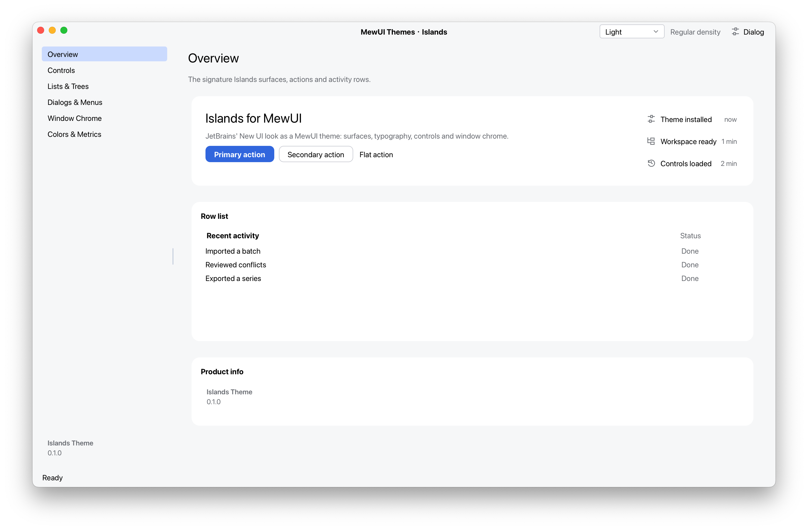

# MewUI.Themes.Islands

An independent Islands-inspired theme for [MewUI](https://github.com/aprillz/MewUI).
It provides light and dark palettes, regular and compact density, control styles,
and reusable workspace, menu and window components.

<p align="center">
  <picture>
    <source media="(prefers-color-scheme: dark)" srcset="docs/screenshots/overview-dark.png">
    <source media="(prefers-color-scheme: light)" srcset="docs/screenshots/overview-light.png">
    
  </picture>
</p>

## Preview status

The first preview is `0.1.0-preview.1`. Public APIs may change between preview releases.
The current dependency and integration baseline is MewUI `0.22.1`.

The library targets `net8.0` and `net10.0`, matching both `Aprillz.MewUI.Core` and
`Aprillz.MewUI` 0.22.1. Building this repository uses the .NET 10 SDK specified in
`src/global.json`; the demo and automated tests run on .NET 10.

See the [package README](src/MewUI.Themes.Islands/README.md) for installation,
startup examples, namespaces, components and validation scope.

## Layout

- `docs/` — color mapping, reference theme data and screenshots
- `src/MewUI.Themes.Islands/` — the packable library
- `src/MewUI.Themes.Islands.Tests/` — automated tests
- `src/MewUI.Themes.Islands.Demo/` — the component gallery

The solution and shared build configuration remain under `src/`.
The library groups palette and metrics in `Theming/`, reusable components in `Controls/`,
menus in `Menus/`, window behavior in `Windowing/`, style rules in `Styles/`, and drawing helpers
in `Drawing/`. Fluent entry points live in `Extensions/` and retain the root namespace.

## Build, test and pack

```sh
cd src
dotnet build MewUI.Themes.Islands.slnx -c Release
dotnet run --project MewUI.Themes.Islands.Tests -c Release
dotnet pack MewUI.Themes.Islands/MewUI.Themes.Islands.csproj -c Release
```

The NuGet package contains assemblies and XML API documentation for both target frameworks,
the package README, LICENSE, third-party notices and Apache 2.0 license text.
A separate `.snupkg` contains debugging symbols.
Reference JSON files and the demo are not included in the package.

## Demo

```sh
cd src
dotnet run --project MewUI.Themes.Islands.Demo -- \
  --theme dark --density compact --page controls
```

`--theme` accepts `system`, `light` or `dark`; `--page` accepts `overview`, `controls`,
`lists & trees`, `dialogs & menus`, `window chrome` or `colors & metrics`.

## References and license

The MewUI theme implementation is MIT licensed; see [LICENSE](LICENSE).
The reference theme data and adapted palette values come from JetBrains under Apache 2.0;
see [reference notes](docs/islands/README.md) and [third-party notices](THIRD-PARTY-NOTICES.md).
The NuGet package declares `MIT AND Apache-2.0` and includes both license texts.
This project is not an official JetBrains or MewUI theme package and is not affiliated with
or endorsed by JetBrains or the MewUI maintainers.
